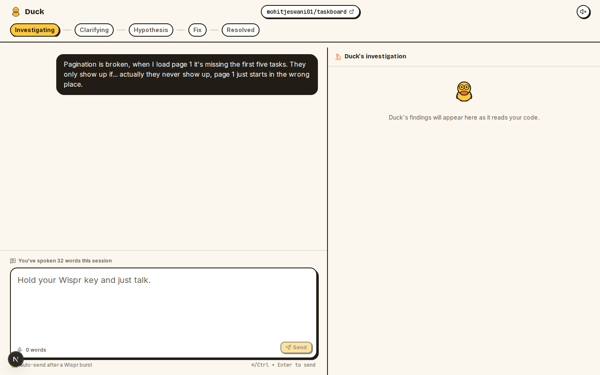
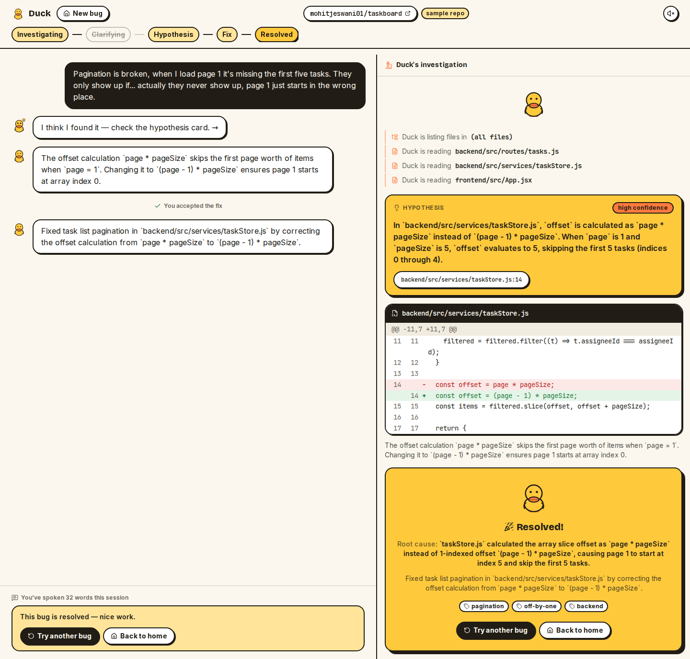
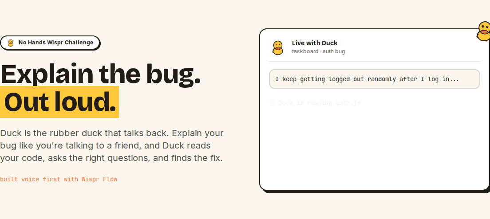
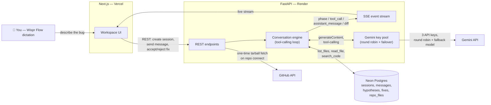

# 🦆 Duck

### Explain the bug. Out loud.

Duck is the rubber duck that talks back. Describe a bug the way you'd explain it to a coworker — out loud, dictated with [Wispr Flow](https://wisprflow.ai) — and Duck reads the actual code in your repo, asks sharp clarifying questions, states a hypothesis with evidence, and proposes a real diff. You accept it, reject it, or push back, and it keeps digging.

Built solo for the **No Hands Wispr Challenge** (WeMakeDevs × Wispr Flow).

**🔗 Live demo:** _[add the deployed Vercel URL here once live]_
**🎥 Demo video:** _[add the video link here]_

---

## Screenshots

| Investigating → Hypothesis → Fix | Resolved |
|---|---|
|  |  |



---

## The problem

Rubber duck debugging is an old, well-proven technique: explain a bug out loud, in order, to something that can't interrupt you, and the act of narrating forces the clarity that finds the bug. It works. Almost nobody does it, because typing out a full explanation is slower than just staring at the code some more — so the technique gets skipped under deadline pressure, exactly when it would help most.

Duck removes the only reason people skip it: you don't type, you talk, and the duck actually responds.

## How Duck works

1. **Connect a repo.** Paste any public GitHub repo, or use the bundled sample repo. Duck downloads it once (a single tarball fetch, not a per-file crawl) and reads from its own copy from then on.
2. **Talk through the bug.** Hold your Wispr key and describe what's happening — rambling, backtracking, and filler words included. Duck reads through all of it silently.
3. **Duck investigates first.** Before asking anything, it decides for itself which files are relevant and reads them (`list_files` / `read_file` / `search_code`), live, with the trace visible in the UI.
4. **It asks, if it needs to.** At most 1–3 focused questions, at most twice, and only after it's actually looked at the code — never as a first move.
5. **It states a hypothesis with evidence** — a plain-English theory plus file:line citations — before proposing anything.
6. **It proposes a fix as a real diff.** The diff is built by the backend from the real file content, never hand-written by the model. Accept it, reject it with feedback, and Duck keeps investigating.
7. **Resolved sessions are the bug journal.** No separate "save" step — a resolved conversation is itself a searchable record for next time the same bug shows up.

## Architecture



Gemini drives the investigation, not hand-written rules — it gets native tool-calling access to the repo and decides what to read and when it has enough evidence. The backend only executes whatever tool call comes back and enforces what's legal in the session's current phase (you can't `propose_fix` from `investigating`, for instance). A hard per-turn wall-clock deadline bounds every turn regardless of how many retries happen inside it — see [Known limitations](#known-limitations).

## Built with Wispr Flow

Two things are true here, not one:

- **This entire project was built by voice.** The plan, the code, the commit messages, this README — all dictated with Wispr Flow, not typed. If Duck only worked for carefully-typed, grammatically clean bug reports, it would have missed its own point.
- **Duck is designed for dictated input, specifically.** The big textarea in the workspace is captioned "hold your Wispr key and just talk," not "type your bug." The system prompt explicitly tells Duck to interpret rambling, filler words, and backtracking charitably, and to read through technical terms that dictation mangles (`expires at` → `expire sat`) silently — never commenting on the transcription, just getting to work. Burst-paste detection in the input (Wispr Flow drops a whole transcript in one `onChange`, not character-by-character) drives an auto-send countdown, so the dictate-and-go loop stays uninterrupted.

## taskboard — the sample repo

[`taskboard`](https://github.com/mohitjeswani01/taskboard) is a small Express + React task manager, built specifically for this demo, with **three real bugs planted on purpose**:

1. **Users get logged out almost immediately after logging in** — should last an hour, doesn't.
2. **The first page of tasks is missing items** — pagination starts in the wrong place.
3. **The status filter works for a second, then reverts to showing everything.**

No bug is hinted at in code comments, names, or taskboard's own README — the answer key lives only in this repo's `docs/sample_bugs.md`, deliberately kept out of taskboard itself so Duck can't read its own answers. Pick any of the three symptom chips on the landing page to watch Duck investigate one live, with zero typing.

## Tech stack

| Layer | Choice |
|---|---|
| Frontend | Next.js 16 (App Router), TypeScript, Tailwind v4, shadcn/ui |
| Backend | FastAPI, Python 3.12, async throughout |
| Database | Postgres on [Neon](https://neon.tech) |
| AI reasoning | Google Gemini (`gemini-3.6-flash`, fallback `gemini-3.8-flash`) via the official `google-genai` SDK, native tool-calling |
| Repo access | GitHub REST API — one metadata call + one tarball download per connect, never per-file fetches |
| Hosting | Frontend → Vercel. Backend → Render free tier. Both talk to the same Neon database. |
| Voice | [Wispr Flow](https://wisprflow.ai) — both to build this project and to use it |

## Running it locally

**Prerequisites:** Python 3.12, Node 20+, a Neon (or any) Postgres database, 1–3 Gemini API keys from [Google AI Studio](https://aistudio.google.com/apikey).

### Backend

```bash
cd backend
python3 -m venv .venv && source .venv/bin/activate   # or use a venv elsewhere — see note below
pip install -r requirements.txt
cp .env.example .env   # fill in DATABASE_URL and GEMINI_API_KEYS at minimum
alembic upgrade head
uvicorn app.main:app --reload --port 8000
```

> If your project directory is on a network/virtual drive (e.g. a Windows drive mounted into WSL), creating the venv *inside* the project can be extremely slow over that filesystem — create it elsewhere (e.g. `~/.venvs/duck-backend`) and point your shell at that instead.

Run the tests:
```bash
pytest
```

### Frontend

```bash
cd frontend
npm install
cp .env.local.example .env.local   # NEXT_PUBLIC_API_URL=http://localhost:8000 is the default
npm run dev
```

Open `http://localhost:3000` — no login, the landing page is live immediately.

### Dev-only tool endpoints (optional)

Set `ENABLE_DEV_TOOLS=true` in the backend `.env` to curl-test `list_files`/`read_file`/`search_code` directly against a connected repo, bypassing the conversation loop. Must stay `false` in production — the routes don't exist at all when it's unset.

## Real evaluation numbers

From `backend/scripts/evaluate.py`, run end-to-end against the real `taskboard` repo and the live Gemini API (the hardening-phase run — see `CLAUDE.md` for the full log):

- **3/3** planted bugs resolved correctly — right file, matched root cause, every run.
- **~30 seconds** from symptom to root cause on the fastest runs (27.6s pagination bug, 31.4s stale-filter bug).
- **6 files read, unprompted** — on the auth-expiry bug, Duck called `list_files`, then read all six relevant files across frontend and backend without being told which ones, before narrowing in on the actual unit mismatch.
- **0 prompt/tool-description changes** were needed after the hardening pass — every remaining issue found during testing was live-API latency/availability, not reasoning or control-flow.

Nothing above is invented for the pitch — it's the literal output of a committed script, re-runnable against the live API.

## Known limitations

- **Gemini's real-time availability is the single biggest risk to a smooth demo.** During development, `generateContent` calls were observed hanging for minutes under real demand, and the backend has layered defenses for this (automatic key/model failover, a hard 90-second wall-clock deadline per turn, a capped retry count) — but a demo running during a bad window can still occasionally need a "keep going" click. This is a live third-party dependency, not something fully within this project's control.
- **Single-instance hosting.** Render's free tier runs one instance; live SSE event queues and in-memory session state are per-process, so a backend restart mid-turn ends that turn (the UI detects this and lets you continue — it won't leave you stuck) but does lose the live tool-call trace for that turn.
- **Free-tier cold starts.** The backend sleeps after 15 minutes idle; a cron ping every 10 minutes keeps it warm, but the very first visit after a gap can take up to ~50 seconds to wake up. The UI shows a "waking Duck up" message and retries automatically rather than failing.
- **Public repos only, small to medium sized** (≤500 files, ≤5MB total) — no private repo support, no partial/incremental indexing of huge monorepos.
- **No persistent bug journal UI yet.** Resolved sessions already carry everything needed to be a journal entry (root cause, summary, tags, full transcript) and are full-text searchable at the database level, but a dedicated journal/search page isn't built yet.
